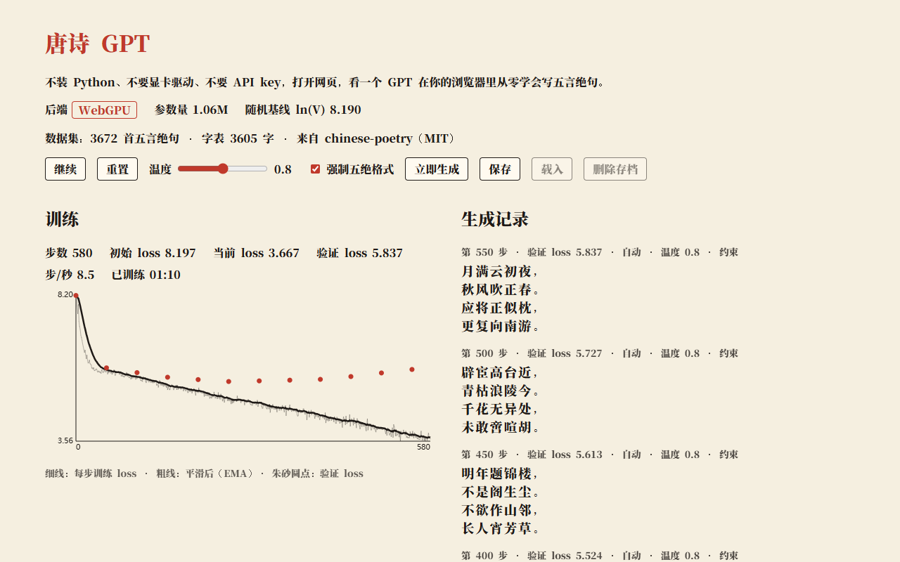
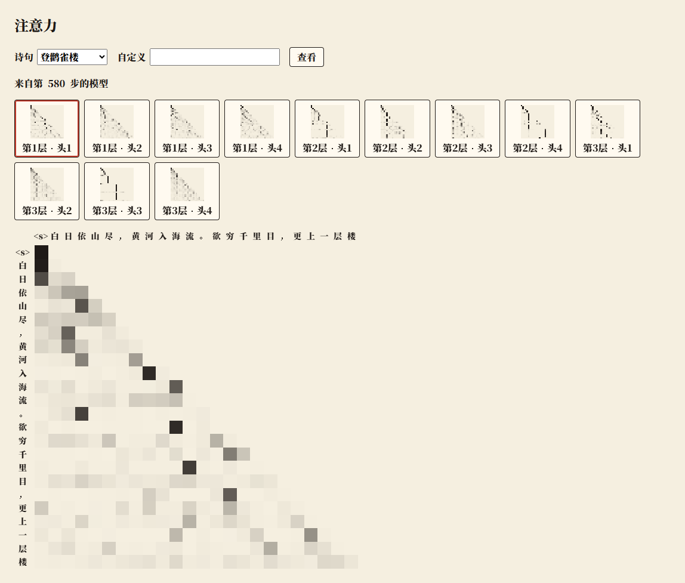
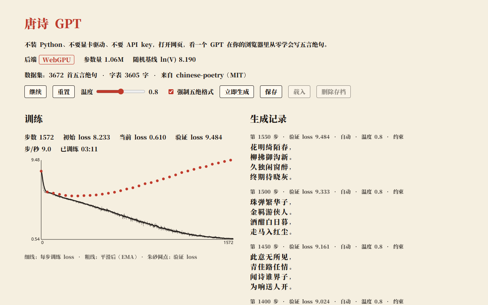

# Tangshi GPT (唐诗 GPT)

Train a ~1M-parameter GPT from random weights in your browser, and watch its poems turn from random characters into something that looks like Tang poetry. No Python, no GPU drivers, no API key.

English | [简体中文](README.zh-CN.md)

**Live demo: https://zhushen12580.github.io/tangshi-gpt/** (Chrome or Edge 113+ recommended for WebGPU)



<sub>580 steps in 1 min 10 s with WebGPU on an Intel Arc 130T integrated GPU. The UI is in Chinese.</sub>

Samples from that same run, at the default temperature of 0.8 with the format switch on:

```text
step   0   碍勿樯攀台，输榭满酲疏。嶂或直五屯，领眄庭逡娃。   (random characters)
step 250   江日直如花，相见旧摇成。酒声空首袖，离得此年亭。   (lowest validation loss of the run)
step 550   月满云初夜，秋风吹正春。应将正似枕，更复向南游。
```

None of these lines appears in the dataset. The model picks up the vocabulary and imagery (moon, autumn wind, river, flowers, wine) but not the meaning. See [What to expect](#what-to-expect).

## Features

- **Live training**: the loss per step and a smoothed EMA, the validation loss every 50 steps, the random baseline ln(V), steps/s and elapsed time.
- **Poems as it learns**: a poem is sampled at step 0 and then every 50 steps, newest first, each labelled with its step and validation loss.
- **Sampling controls**: temperature from 0.1 to 1.5, a "force quatrain format" switch, and a "generate now" button that also works mid-training. Free samples get a 「格式 ✓」 or 「格式 ✗」 badge, so you can see when the model has learned the format by itself.
- **Attention heatmaps**: all 3 layers × 4 heads for a preset poem, the latest sample or a poem you type in. You can enlarge one head and read each weight with the mouse or the arrow keys.
- **Pause, save and resume**: one checkpoint slot in IndexedDB holds the weights, the Adam state, the loss history and the samples.
- **Automatic fallback**: WebGPU, then WebGL, then CPU. Each backend must pass a quick forward/backward self-test before it is used.
- **One file to read**: the GPT is written by hand from TensorFlow.js core ops in [`src/model.ts`](src/model.ts), 210 lines with comments in Chinese.
- **Reproducible data**: 3672 quatrains from [chinese-poetry](https://github.com/chinese-poetry/chinese-poetry) (MIT) at a pinned commit, rebuilt byte for byte by one command.

## Quick start

You need Node.js 22.12+ (22.x), 24.x or 26+ and npm. The dataset ships with the repository, so the app needs no network access once installed. These commands work as-is in both PowerShell and bash:

```sh
git clone https://github.com/zhushen12580/tangshi-gpt.git
cd tangshi-gpt
npm ci
npm run dev
```

Open http://localhost:5173/ and click **开始训练** (Start training). If port 5173 is busy, Vite picks another one and prints the URL.

The Node.js range is the `engines` field in `package.json`. Vitest 5, which runs the unit tests, supports only these versions; Vite 8 alone would also run on 20.19+. Older releases such as Node.js 20.0 cannot even start Vite. The project was developed on Node.js 22.20.

## Usage

- **开始训练 / 暂停 / 继续** (Start / Pause / Resume): start or pause the training loop. Pausing takes effect at once; if the validation loss and poem of a 50-step milestone are still being computed, they finish in the background and then appear. **重置** (Reset) re-initializes the model; saved checkpoints are kept.
- **温度** (Temperature): sampling temperature, 0.1–1.5, default 0.8.
- **强制五绝格式** (Force quatrain format): when checked, sampling is constrained to 4 lines of 5 characters with the punctuation 「，。，。」. Uncheck it to see whether the model has learned the format by itself; free samples get a 「格式 ✓」 or 「格式 ✗」 badge.
- **立即生成** (Generate now): write a poem right away, even at step 0 before training. While training, it appears after the current step finishes; training is not interrupted.
- **保存 / 载入 / 删除存档** (Save / Load / Delete checkpoint): one checkpoint slot, stored in your browser's IndexedDB. After a reload the page offers to load it (「载入」) or dismiss the prompt (「忽略」).
- **注意力** (Attention):
  - Pick one of the preset poems (登鹳雀楼, 春晓, 相思, 鹿柴) or the latest generated poem (最新生成的诗) to see 12 small heatmaps (3 layers × 4 heads) and an enlarged one.
  - Or type your own poem into **自定义** and press **查看** (View). It must be exactly 20 Chinese characters. Whitespace and punctuation are ignored, and every character must be in the model's vocabulary.
  - Click a small heatmap, or Tab to it and press Enter, to enlarge that head. Focus the enlarged heatmap and use the arrow keys to move the highlighted cell; the weight is shown below it, e.g. 「「海」看「黄」：0.31」.
- **Keyboard**: Tab reaches every button, slider and checkbox. Arrow keys change the slider by 0.1, Space toggles the checkbox, Enter activates buttons.



### Choosing a backend

By default the page tries WebGPU → WebGL → CPU and uses the first one that passes the self-test. The badge in the header shows the backend in use. To start from a specific backend, add a query parameter:

- `?backend=webgpu`: same as the default
- `?backend=webgl`: skip WebGPU
- `?backend=cpu`: CPU only (very slow)

If the requested backend fails, the page falls back to the next one and says so. Unknown values are treated as automatic.

## What to expect

The model has about 1M parameters and the training set has 3488 poems, with no dropout. It learns fast and then overfits, and the chart shows both. Here is the run from the screenshot above, continued to 1572 steps (3 min 11 s):



- **Step 0**: the loss is close to ln(V) ≈ 8.19, the loss of guessing uniformly, and the poems are random, often rare characters.
- **First ~250 steps** (about 30 s here): the validation loss drops to about 5.5. Common characters and typical imagery appear, but the lines do not make sense.
- **After that**: the training loss keeps falling while the validation loss climbs. The model is memorizing. At step 1572 the training loss is 0.61, and the step-1500 sample 「珠弹繁华子，金羁游侠人。酒酣白日暮，走马入红尘。」 is a poem copied verbatim from the training set.

With the format switch on (the default), every sample has the quatrain shape from step 0, because the constraint is a mask on the output. Switch it off to see the model learn the shape by itself.

## How it works

```
public/data/poems.json ─▶ data.ts ─▶ train.ts ◀──▶ model.ts
                                        │ every 50 steps
                                        ├─▶ sample.ts      → poem log
                                        ├─▶ validation loss → loss chart
                                        └─▶ attention maps  → heatmaps
```

- **Data** ([`src/data.ts`](src/data.ts)): each poem is exactly 24 characters (4 × 5 characters plus 「，。，。」), so one poem is one training sample and no padding is needed. The vocabulary is every character in the dataset plus `<s>`, 3605 tokens in all. Every 20th poem (184 poems) goes to the validation set.
- **Model** ([`src/model.ts`](src/model.ts)): a decoder-only GPT with pre-LayerNorm, 3 layers, 4 heads, d_model 128, FFN 512, GELU, learned position embeddings and tied input/output embeddings: 1.06M parameters. The input is `<s>` plus the first 23 characters, and the target is all 24. It uses only `@tensorflow/tfjs-core` ops and the gradients that come with tfjs-core; there is no `tfjs-layers`.
- **Training** ([`src/train.ts`](src/train.ts)): Adam with a fixed learning rate of 2e-3 and a batch of 64 (32 on CPU), run on the main thread. The loop yields to the UI after every step, so pause, generate and save stay responsive. Every 50 steps it samples a poem, computes the loss on the whole validation set and refreshes the heatmaps if they are visible.
- **Sampling** ([`src/sample.ts`](src/sample.ts)): 24 characters are generated one at a time, using a softmax with temperature. The quatrain format is a mask on the logits: positions 6, 12, 18 and 24 must be 「，。，。」 and punctuation is blocked everywhere else.
- **Backends** ([`src/backend.ts`](src/backend.ts)): each candidate backend runs a tiny forward and backward pass. It is used only if that pass succeeds and gives finite values.
- **Checkpoints** ([`src/checkpoint.ts`](src/checkpoint.ts)): the weights, the Adam moments and the histories are saved to IndexedDB, about 13 MB, so resuming does not reset the optimizer.
- **Drawing**: plain Canvas 2D and DOM, with no UI framework and no chart library.

## About speed

Speed depends entirely on your hardware, so the page shows the real steps/s (「步/秒」) while training. The design target is about 1500 steps in roughly 3 minutes on an ordinary laptop with **WebGPU or WebGL hardware acceleration enabled** (≥ 8 steps/s with the default settings). Measured numbers:

| Setup | Speed |
| --- | --- |
| WebGPU on an Intel Arc 130T integrated GPU | ~7–9 steps/s (1572 steps in 3 min 11 s) |
| Software WebGL (SwiftShader, e.g. headless test runs) | ~0.7 steps/s |
| CPU backend | very slow: ~20 s per step |

## Tests

```sh
npm test
npm run test:coverage
npx playwright install chromium
npm run test:e2e
```

- `npm test` runs the Vitest unit tests in Node, including the dataset checks.
- `npm run test:coverage` checks ≥ 80% line coverage of the core modules.
- `npx playwright install chromium` is only needed once.
- `npm run test:e2e` builds the app, serves it at http://localhost:4173/tangshi-gpt/ and runs the Playwright tests in Chromium. Port 4173 must be free. Training runs on software WebGL, so the whole run takes a while: 28 tests took about 22 minutes on the development machine.

## Build and deploy

```sh
npm run build
npm run preview
```

Open http://localhost:4173/tangshi-gpt/ (keep the trailing slash). The output in `dist/` is plain static files that work under any sub-path, because Vite is configured with `base: './'`.

To deploy to GitHub Pages, set **Settings → Pages → Source** to **GitHub Actions**. On every push to `main`, [`.github/workflows/pages.yml`](.github/workflows/pages.yml) runs `npm ci`, `npm test` and `npm run build`, then deploys `dist/` to `https://<owner>.github.io/<repo>/`. Both jobs are skipped while the repository is private. The e2e tests are not part of the workflow, because hosted runners have no GPU and software WebGL training is too slow; run them locally.

## Dataset

`public/data/poems.json` holds 3672 strict five-character quatrains (5 characters + punctuation × 4 lines), converted to Simplified Chinese. They come from [chinese-poetry](https://github.com/chinese-poetry/chinese-poetry) (MIT) at the fixed commit `b8594f81a89752241442f2ce267d6f66f96704ee`. To rebuild it byte-for-byte (needs network access):

```sh
npm run build:data
```

If `raw.githubusercontent.com` is slow or unreachable, point `CHINESE_POETRY_BASE` at a mirror (or at a local clone of chinese-poetry checked out at that commit). [`.env.example`](.env.example) documents the variable; the script reads it from your shell, not from a `.env` file.

PowerShell:

```powershell
$env:CHINESE_POETRY_BASE='https://cdn.jsdelivr.net/gh/chinese-poetry/chinese-poetry@b8594f81a89752241442f2ce267d6f66f96704ee/'
npm run build:data
```

bash:

```sh
CHINESE_POETRY_BASE='https://cdn.jsdelivr.net/gh/chinese-poetry/chinese-poetry@b8594f81a89752241442f2ce267d6f66f96704ee/' npm run build:data
```

Afterwards `git status --porcelain public/data` should print nothing. Source and license details are in [`public/data/NOTICE.txt`](public/data/NOTICE.txt).

## License

MIT, see [LICENSE](LICENSE). The dataset is from chinese-poetry, also MIT.

Built with Claude Code & Codex
