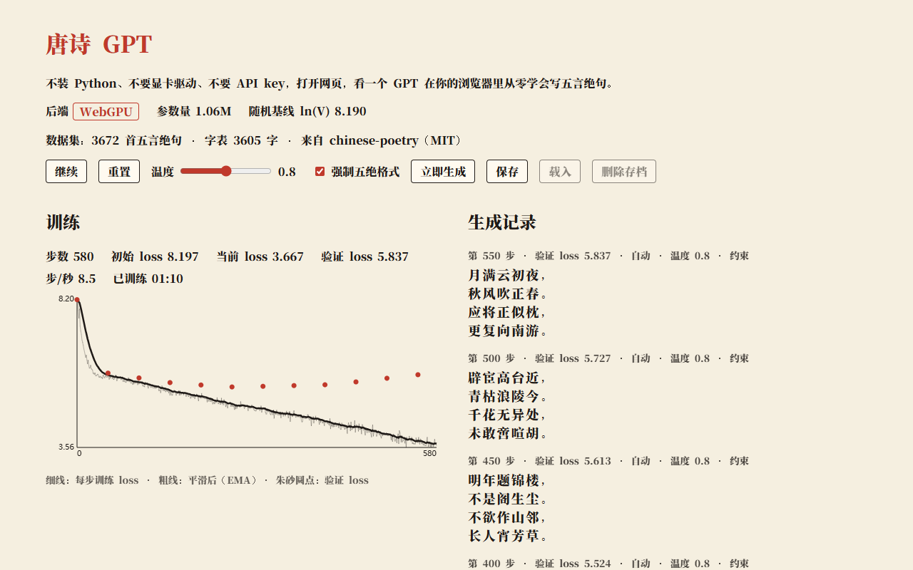
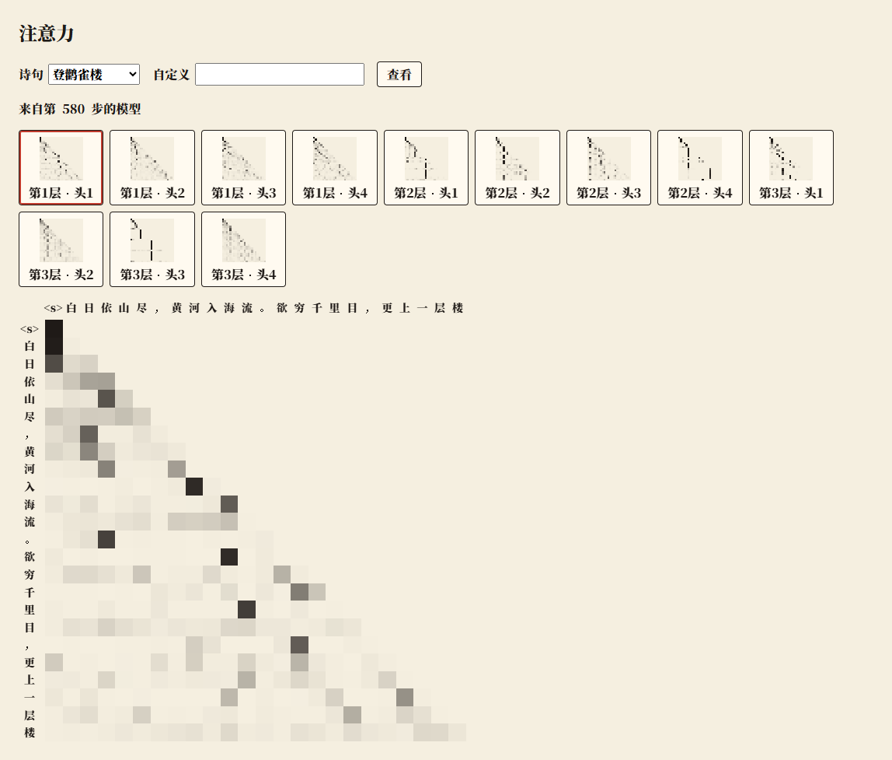
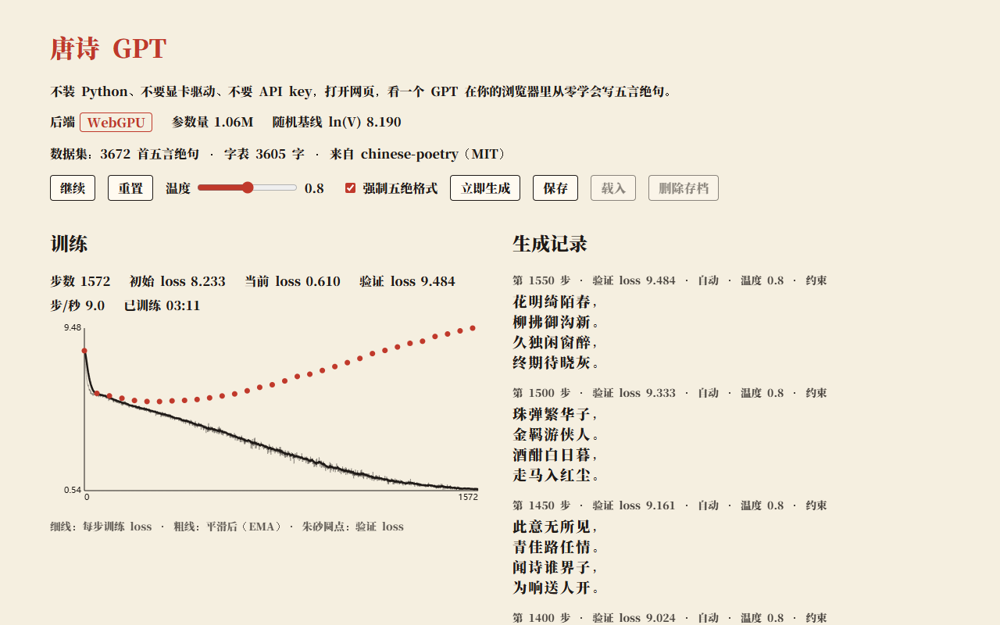

# 唐诗 GPT

在浏览器里从随机权重开始训练一个约 100 万参数的 GPT，看它写的诗从一堆乱字，慢慢变得有几分唐诗的样子。不装 Python，不要显卡驱动，也不要 API key。

[English](README.md) | 简体中文

**在线体验：<https://zhushen12580.github.io/tangshi-gpt/>**（推荐 Chrome 或 Edge 113+，可以用上 WebGPU）



<sub>Intel Arc 130T 核显，WebGPU 后端，580 步用时 1 分 10 秒。</sub>

同一次训练中自动生成的几首（温度 0.8，开启「强制五绝格式」）：

```text
第   0 步   碍勿樯攀台，输榭满酲疏。嶂或直五屯，领眄庭逡娃。   （随机乱字）
第 250 步   江日直如花，相见旧摇成。酒声空首袖，离得此年亭。   （这次训练验证 loss 最低的时候）
第 550 步   月满云初夜，秋风吹正春。应将正似枕，更复向南游。
```

这些句子在数据集里都找不到。模型学会了唐诗常用的字和意象，比如月、秋风、江、花、酒，但还写不出意思。详见[会看到什么](#会看到什么)。

## 功能

- **实时训练**：每步 loss 和平滑后的 EMA 曲线，每 50 步一次的验证 loss，随机基线 ln(V)，以及步/秒和已训练时长。
- **边训练边写诗**：第 0 步和之后每 50 步各写一首，最新的在最上面，标注步数和当时的验证 loss。
- **采样可调**：温度 0.1–1.5；「强制五绝格式」开关；「立即生成」训练中也能用，不打断训练。关掉格式约束后，每首诗带「格式 ✓」或「格式 ✗」，能看出模型什么时候自己学会了格式。
- **注意力热力图**：3 层 × 4 头共 12 张图，可以看预设诗、最新生成的诗，也可以自己输入一首。点任意一张放大，用鼠标或方向键查看每一格的权重。
- **暂停、存档、接着练**：IndexedDB 里有一个存档槽，保存权重、Adam 状态、loss 历史和生成记录。
- **自动降级**：依次尝试 WebGPU、WebGL、CPU，每个后端都要先通过一次前向加反向的自检才会启用。
- **一个文件读懂 GPT**：模型只用 TensorFlow.js 的基础张量算子手写，全在 [`src/model.ts`](src/model.ts) 里，210 行，带中文注释。
- **数据可复现**：3672 首五言绝句来自 [chinese-poetry](https://github.com/chinese-poetry/chinese-poetry)（MIT），锁定 commit，一条命令就能逐字节重新生成。

## 快速开始

需要 Node.js 22.12+（22.x）、24.x 或 26+，以及 npm。数据集随仓库提供，装好依赖后运行时不用联网。下面的命令在 PowerShell 和 bash 里都能直接用：

```sh
git clone https://github.com/zhushen12580/tangshi-gpt.git
cd tangshi-gpt
npm ci
npm run dev
```

打开 http://localhost:5173/ ，点「开始训练」。如果 5173 端口被占用，Vite 会换一个端口并打印出地址。

Node.js 的版本范围就是 `package.json` 里的 `engines`：跑单元测试的 Vitest 5 只支持这些版本（只跑 Vite 8 的话 20.19+ 也行）。Node.js 20.0 这类更老的版本连 Vite 都启动不了。开发时用的是 Node.js 22.20。

## 使用说明

- **开始训练 / 暂停 / 继续**：开始或暂停训练。暂停立即生效；如果某个 50 步节点的验证 loss 和诗还没算完，它们会在后台算完再显示。**重置**会重新初始化模型，已有的存档不会删。
- **温度**：采样温度，范围 0.1–1.5，默认 0.8。
- **强制五绝格式**：勾选时，采样被限制为 4 行、每行 5 个字，标点依次为「，。，。」。取消勾选，就能看模型自己有没有学会格式，每首诗会带「格式 ✓」或「格式 ✗」。
- **立即生成**：马上写一首，第 0 步还没训练时也可以。训练中点击的话，会在当前这一步结束后出现，训练不中断。
- **保存 / 载入 / 删除存档**：只有一个存档槽，存在浏览器的 IndexedDB 里。刷新页面后会提示发现存档，可以「载入」或「忽略」。
- **注意力**：
  - 在下拉框里选一首预设诗（登鹳雀楼、春晓、相思、鹿柴）或「最新生成的诗」，会显示 12 张小热力图（3 层 × 4 头）和一张放大图。
  - 也可以在「自定义」里输入一首诗，点「查看」。必须恰好 20 个汉字，空白和标点会被忽略，每个字都要在模型的字表里。
  - 点一张小图，或者用 Tab 聚焦后按 Enter，放大这个头。聚焦放大图后用方向键移动高亮格，下方会显示权重，例如「「海」看「黄」：0.31」。
- **键盘**：Tab 能走到每个按钮、滑块和复选框。方向键每次把滑块调 0.1，空格切换复选框，Enter 触发按钮。



### 选择后端

默认依次尝试 WebGPU → WebGL → CPU，用第一个通过自检的。页头的徽章显示当前用的是哪一个。想从某个后端开始，可以在地址后面加参数：

- `?backend=webgpu`：和默认一样
- `?backend=webgl`：跳过 WebGPU
- `?backend=cpu`：只用 CPU（非常慢）

指定的后端不可用时，页面会降级到下一个，并给出提示。不认识的值按自动处理。

## 会看到什么

模型约 100 万参数，训练集只有 3488 首诗，也没有 dropout，所以学得快，过拟合也来得快，这两件事在曲线上都看得见。下面是上图那次训练继续跑到第 1572 步（用时 3 分 11 秒）的样子：



- **第 0 步**：loss 接近 ln(V) ≈ 8.19，也就是均匀乱猜的水平，写出来的是随机乱字，生僻字很多。
- **前 250 步左右**（这台机器上约 30 秒）：验证 loss 降到 5.5 左右。常用字和典型意象出现了，但句子不通。
- **再往后**：训练 loss 继续下降，验证 loss 却开始回升，模型在背诗。到第 1572 步，训练 loss 是 0.61；第 1500 步写出的「珠弹繁华子，金羁游侠人。酒酣白日暮，走马入红尘。」就是训练集里一首诗的原文。

「强制五绝格式」默认开启时，从第 0 步起每首都是五绝的样子，因为这个约束只是输出上的一个掩码。关掉它，才能看到模型自己学会格式的过程。

## 实现原理

```
public/data/poems.json ─▶ data.ts ─▶ train.ts ◀──▶ model.ts
                                        │ 每 50 步
                                        ├─▶ sample.ts  → 生成记录
                                        ├─▶ 验证 loss  → loss 曲线
                                        └─▶ 注意力     → 热力图
```

- **数据**（[`src/data.ts`](src/data.ts)）：每首诗正好 24 个字符（4 × 5 个字，加上「，。，。」），一首诗就是一个训练样本，不用 padding。字表是数据集里出现过的所有字再加一个 `<s>`，共 3605 个。每 20 首取 1 首进验证集，共 184 首。
- **模型**（[`src/model.ts`](src/model.ts)）：decoder-only GPT，pre-LayerNorm，3 层、4 头，d_model 128，FFN 512，GELU，学习得到的位置嵌入，输入输出嵌入共享权重，共 106 万参数。输入是 `<s>` 加前 23 个字，预测全部 24 个字。只用 `@tensorflow/tfjs-core` 的算子和它自带的梯度，没用 `tfjs-layers`。
- **训练**（[`src/train.ts`](src/train.ts)）：Adam，固定学习率 2e-3，batch 64（CPU 上是 32），在主线程上训练。每一步结束后都让出主线程，所以暂停、立即生成、保存都能及时响应。每 50 步写一首诗、在整个验证集上算一次 loss；热力图可见时也刷新一次。
- **采样**（[`src/sample.ts`](src/sample.ts)）：逐字生成 24 个字符，logits 除以温度后做 softmax 抽样。五绝格式就是 logits 上的一个掩码：第 6、12、18、24 位只能是「，。，。」，其他位置屏蔽这两个标点。
- **后端**（[`src/backend.ts`](src/backend.ts)）：每个候选后端都先用一个很小的模型跑一次前向和反向，不报错、结果是有限值才会用它。
- **存档**（[`src/checkpoint.ts`](src/checkpoint.ts)）：权重、Adam 的一阶和二阶矩、各种历史记录一起存进 IndexedDB，约 13 MB，接着训练时优化器状态不会清零。
- **绘图**：原生 Canvas 2D 和 DOM，不用 UI 框架，也不用图表库。

## 关于速度

速度完全取决于硬件，所以训练时页面会实时显示「步/秒」。设计目标是在开启了 **WebGPU 或 WebGL 硬件加速**的普通笔记本上，约 3 分钟跑完约 1500 步（默认配置下 ≥ 8 步/秒）。实测数据：

| 环境 | 速度 |
| --- | --- |
| WebGPU，Intel Arc 130T 核显 | 约 7–9 步/秒（1572 步用时 3 分 11 秒） |
| 软件 WebGL（SwiftShader，例如无头测试） | 约 0.7 步/秒 |
| CPU 后端 | 非常慢：每步约 20 秒 |

## 测试

```sh
npm test
npm run test:coverage
npx playwright install chromium
npm run test:e2e
```

- `npm test`：在 Node 里跑 Vitest 单元测试，包括数据集校验。
- `npm run test:coverage`：检查核心模块的行覆盖率 ≥ 80%。
- `npx playwright install chromium`：只需执行一次。
- `npm run test:e2e`：先构建，再在 http://localhost:4173/tangshi-gpt/ 上用 Chromium 跑 Playwright 测试，需要 4173 端口空闲。训练走的是软件 WebGL，整轮比较慢：开发机上 28 个用例约 22 分钟。

## 构建与部署

```sh
npm run build
npm run preview
```

打开 http://localhost:4173/tangshi-gpt/ （注意末尾的斜杠）。`dist/` 里全是静态文件，Vite 配置了 `base: './'`，所以放在任何子路径下都能运行。

部署到 GitHub Pages：在仓库 **Settings → Pages → Source** 里选 **GitHub Actions**。之后每次推送到 `main`，[`.github/workflows/pages.yml`](.github/workflows/pages.yml) 都会执行 `npm ci`、`npm test`、`npm run build`，再把 `dist/` 发布到 `https://<owner>.github.io/<repo>/`。仓库为私有时，两个 job 都会跳过。e2e 不在工作流里跑：托管 runner 没有 GPU，软件 WebGL 训练太慢，请在本地运行。

## 数据集

`public/data/poems.json` 收录 3672 首格式严格的五言绝句（每行 5 个字加标点，共 4 行），已转为简体。它们来自 [chinese-poetry](https://github.com/chinese-poetry/chinese-poetry)（MIT）的固定 commit `b8594f81a89752241442f2ce267d6f66f96704ee`。逐字节重新生成（需要联网）：

```sh
npm run build:data
```

如果 `raw.githubusercontent.com` 很慢或连不上，可以把 `CHINESE_POETRY_BASE` 指向镜像，或者指向检出到该 commit 的 chinese-poetry 本地 clone。[`.env.example`](.env.example) 里有说明；脚本从 shell 读取这个变量，不读 `.env` 文件。

PowerShell：

```powershell
$env:CHINESE_POETRY_BASE='https://cdn.jsdelivr.net/gh/chinese-poetry/chinese-poetry@b8594f81a89752241442f2ce267d6f66f96704ee/'
npm run build:data
```

bash：

```sh
CHINESE_POETRY_BASE='https://cdn.jsdelivr.net/gh/chinese-poetry/chinese-poetry@b8594f81a89752241442f2ce267d6f66f96704ee/' npm run build:data
```

完成后 `git status --porcelain public/data` 应该没有任何输出。来源和许可的详细信息见 [`public/data/NOTICE.txt`](public/data/NOTICE.txt)。

## 许可证

MIT，见 [LICENSE](LICENSE)。数据集来自 chinese-poetry，同样是 MIT 许可。

Built with Claude Code & Codex
